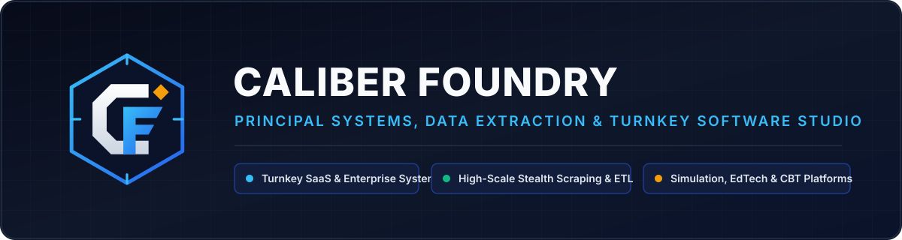



  

## Engineering Production-Grade Systems in Days, Not Quarters

**Caliber Foundry** is a specialized software engineering and product studio focused on deterministic data extraction pipelines, multi-document enterprise verification workflows, and interactive regulatory simulation platforms.

- **Studio Showcase:** [**https://caliberfoundry.com**](https://caliberfoundry.com)
- **Flagship Product (CodeDrill™ CBT):** [**https://caliberfoundry.com/codedrill-cbt/**](https://caliberfoundry.com/codedrill-cbt/)
- **Direct Engineering & Project Intake:** [**engineering@caliberfoundry.com**](mailto:engineering@caliberfoundry.com)

---

### Core Systems & Live Deployments

| System / Platform | Domain | Architecture & Capabilities | Live Interactive Deployment |
| :--- | :--- | :--- | :--- |
| **StealthFlow™ Extraction Hub** | Data Engineering & Web ETL | 12-source concurrent Playwright & XHR/GraphQL extraction engine with Pydantic v2 schema enforcement, URL canonicalization, and HMAC-SHA256 webhook dispatch. | [**Launch StealthFlow™ ↗**](https://caliberfoundry.com/stealthflow/) |
| **OmniRAG™ Document Studio** | Enterprise Document Systems | Deterministic multi-document (PDF, DOCX, XLSX) ingestion and graph-orchestrated verification with page- and cell-level citation grounding. | [**Launch OmniRAG™ ↗**](https://caliberfoundry.com/omnirag/) |
| **EdTech & Clinical Assessment Studio** | EdTech & Regulatory Compliance | Client-side FERPA zero-PII WebCrypto AES-256-GCM assessment reasoning engine (TTL-MSM) & automated SCORM 1.2 package generator. | [**Launch EdTech Studio ↗**](https://caliberfoundry.com/edtech-studio/) |
| **CodeDrill™ CBT Simulator** | Federal Licensing & CBT Simulation | 1:1 Pearson VUE split-screen exam simulator & citation-speed drill platform built on public-domain 19 CFR, HTSUS, and 31 CFR Part 10 corpora. | [**Launch CodeDrill™ CBT ↗**](https://caliberfoundry.com/codedrill-cbt/) |

---

### Technical Standards & Contact

- **Zero-Fluff Proof-of-Concept Delivery:** Every system is shipped with live staging deployments, deterministic schema validation, and end-to-end automated browser verification.
- **Core Stack:** TypeScript, Python (FastAPI, Playwright, Pydantic v2), Go (gRPC, mTLS), React / Next.js, PostgreSQL (pgvector), Cloudflare Workers / Durable Objects.
- **Inquiries & Contract Sprints:** [engineering@caliberfoundry.com](mailto:engineering@caliberfoundry.com)

